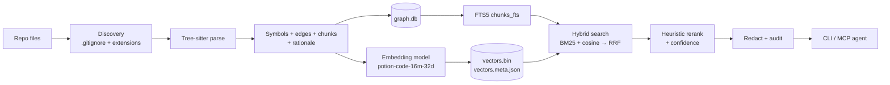
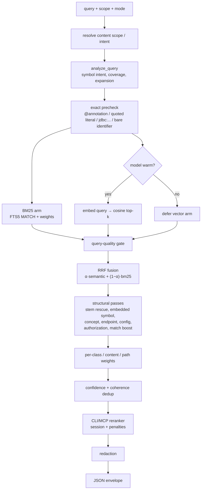

# code-search: End-to-End Walkthrough

**Indexing → what is persisted → how an AI agent's query is matched → what is returned**

This document follows one small sample repository through the entire engine. Every
number and row shown below was produced by actually running this version of
`code-search` against the sample; nothing is illustrative pseudo-data.

---

## 1. The mental model

`code-search` is a **local, offline, lexical + vector retrieval engine over code**.
It is not an LLM and it does not summarise anything. It does four things:

1. **Index**: walk a repository, parse each file with Tree-sitter, extract
   symbols/edges/chunks, embed each chunk with a small static model, and persist
   everything under `.context/`.
2. **Retrieve**: given a natural-language or symbol-shaped query, run a BM25
   (SQLite FTS5) arm and a dense-vector arm in parallel, fuse their rankings, and
   re-rank with structural heuristics.
3. **Serve**: expose the raw matching chunks (with file path, line range, FQN,
   content, scores, confidence) to a CLI or to an MCP-compatible AI agent.
4. **Record**: append an audit entry for every query; optionally track freshness
   and session activity.

There is **no network call at query time and no model inference beyond a
32-dimensional static embedding lookup**. Everything lives in `.context/`.



---

## 2. The sample program

The sample lives at `/tmp/cs-demo` and deliberately contains one file per content
axis (code, config, docs) plus a test file.

### `src/auth/jwt_service.py`

```python
"""JWT validation helpers."""

import hashlib


class TokenError(Exception):
    """Raised when a token is invalid."""


class JwtService:
    """Validates and issues JSON Web Tokens."""

    def __init__(self, secret: str) -> None:
        self.secret = secret

    def validate_token(self, token: str) -> bool:
        """Return True when the token signature matches."""
        expected = self._sign(token)
        return expected == self._sign(token)

    def _sign(self, token: str) -> str:
        return hashlib.sha256((self.secret + token).encode()).hexdigest()


def authenticate(token: str) -> bool:
    """Convenience wrapper around JwtService.validate_token."""
    service = JwtService(secret="demo")
    return service.validate_token(token)
```

### `src/api/controller.py`

```python
"""HTTP controller for authenticated requests."""

from src.auth.jwt_service import TokenError, authenticate


def login_user(token: str) -> dict:
    """Validate a token and return a small session payload."""
    try:
        if not authenticate(token):
            raise TokenError("bad token")
    except TokenError:
        return {"ok": False}
    return {"ok": True, "user": "demo"}
```

### `tests/test_jwt.py`

```python
from src.auth.jwt_service import authenticate


def test_authenticate() -> None:
    """A token must be validated by the service."""
    assert authenticate("token")
```

### `docs/auth.md`

```markdown
# Authentication

The JWT flow validates a bearer token and returns a session payload.
See `JwtService.validate_token` for the signature check.
```

### `config/application.properties`

```properties
app.name=CodeSearchDemo
db.url=jdbc:postgresql://localhost:5432/demo
db.password=demo-secret-value
jwt.secret=super-secret-value
```

This gives us: Python functions/classes/methods, a cross-file import, a test
file, prose, and configuration — enough to exercise every storage table.

---

## 3. Where everything is stored

The CLI defaults the context directory to `<repo-root>/.context`. Running:

```bash
code-search index --path /tmp/cs-demo --include-resources
```

produced:

```
/tmp/cs-demo/.context/
├── graph.db            # symbols, edges, chunks, FTS, checksums, metadata
├── session.db          # READ/WRITE activity for personalised ranking
├── audit.db            # append-only query audit log
├── vectors.bin         # raw float32 vectors, no header
├── vectors.meta.json   # NDJSON metadata, one line per vector
├── vectors.removed     # append-only tombstone row indices
└── index.lock          # present only while an index is running
```

Observed sizes for the sample:

| File | Size | Meaning |
|---|---:|---|
| `graph.db` | 212,992 B | SQLite database (schema v14) |
| `session.db` | 32,768 B | SQLite database |
| `audit.db` | 20,480 B | SQLite database |
| `vectors.bin` | 1,920 B | `15 vectors × 32 dims × 4 bytes` |
| `vectors.meta.json` | 2,667 B | 15 NDJSON lines |
| `vectors.removed` | 0 B | no tombstones yet |

There is one more important location used only when the model is not bundled:
`models/potion-code-16m-32d/` (or one of ten documented fallback paths, including
`CODE_SEARCH_MODEL_PATH` and the Hugging Face cache). **The index and query paths
never download anything**; the only optional download is the interactive prompt
during `index` when the model is absent.

---

## 4. Indexing, step by step

Entry point: `code_search/cli/main.py::cmd_index` →
`code_search/engine/indexer.py::IndexOrchestrator.index_codebase`.

### 4.0 Component wiring and guards

`_initialize_components(context_dir)` opens/creates:

- `GraphDatabase` (`graph.db`) and runs `initialize()` → all DDL + migrations;
- `IndexMetadataStore`, `EdgeStore`, `ModuleEdgeStore`, `RationaleStore`,
  `DocLinkStore`;
- `ASTParser`, `SymbolExtractor`, `SymbolStore`;
- `EmbeddingGenerator` + `VectorIndex` (loads existing vectors);
- `SessionDatabase`, `AuditDatabase`, `FreshnessChecker`;
- `HybridSearch`, `Reranker`, `Redactor`, `MetricsCollector`.

Then the orchestrator enforces invariants **before reading a single file**:

1. **Filesystem lock** (`index.lock`, `O_CREAT | O_EXCL`). Concurrent indexing
   is refused; a lock older than `lock_timeout` may be force-released.
2. **Schema version check** (`index_version`). The sample records `14`. An older
   schema forces a full re-index.
3. **Index status check**. `stale` forces a full re-index. A crashed run that
   left `indexing` is recovered by `cmd_index` when no live lock exists.
4. **Representation-scheme check** (`representation_scheme_version`). The sample
   records `1`. A mismatch forces a full re-index because stored vectors were
   produced from a different chunk-text representation.
5. **Model availability check**. If the model is missing, indexing proceeds
   BM25-only and records `vector_model_available=false` honestly.
6. Status is set to `indexing` before phase 1.

### 4.1 Phase 1 — discovery (serial)

`ASTParser.discover_files` walks the tree with `os.walk` and filters:

- **Directory exclusions**: `.git`, `node_modules`, `__pycache__`, `.venv`,
  `venv`, `.context`, `dist`, `build`, `target`, `out`, `bin`, `.gradle`,
  `.next`, `.output`, `.egg-info`, caches, `.opencode`, `.claude`, `.agents`,
  `graphify-out`, plus explicit `--exclude` patterns. A directory match prunes
  the whole subtree.
- **`.gitignore`**: `GitIgnoreMatcher` uses `pathspec`'s `gitwildmatch`;
  nested `.gitignore` files are layered parent → child, and a path under an
  ignored directory stays ignored even if a deeper rule tries to negate it.
- **File-name exclusion**: `.DS_Store`.
- **Extension → language**: `LANGUAGE_MAP` (`.py` → python, `.java` → java,
  `.js/.jsx` → javascript, `.ts/.tsx` → typescript, `.go`, `.rs`, `.rb`,
  `.swift`, `.kt`, `.php`, `.sh`, `.yaml`, `.toml`, …).
- **Resource files**: when `--include-resources` is set, extensions in
  `resource_extensions` (default `.xml,.sql,.properties,.gradle,.yml,.yaml,.json,.toml`)
  are accepted even without an AST grammar.
- **Prose**: `index_prose` defaults to **true**, so `.md/.markdown/.rst/.txt/.adoc`
  and lockfiles are indexed as raw text. Shell scripts are skipped unless prose
  indexing is enabled.

The result is a sorted `list[Path]`. In the sample: **5 files**.

### 4.2 Incremental diffing (only with `--incremental`)

For every discovered file the engine looks up `file_checksums`:

- if stored `checksum`, `size`, and `file_mtime_ns` all match → skip entirely;
- if the stat differs but the SHA-256 matches → skip (mtime-only touch);
- if the hash differs → re-process;
- files present in the index but no longer discovered → orphaned → delete all
  their rows from `symbols`, `graph_edges`, `code_chunks`, `chunks_fts`,
  `module_edges`, `doc_links`, and tombstone their vectors.

Full indexing (`--force` or a first run) instead clears every table and the
vector index. FTS triggers are suspended while `code_chunks` is cleared, then
restored — this avoids an external-content FTS5 inconsistency.

### 4.3 Phase 2 — parse (parallel)

Each selected file becomes one worker argument `(path, bytes, language, resource_extensions)`.
`_process_file_worker` runs in a `spawn` process pool when the batch is large
enough (≥ 50 files per worker); small repositories parse in-process. The worker
receives the already-read bytes, is otherwise pure, builds an AST, and returns a
serialisable dict.

#### Symbols

`SymbolExtractor.extract_symbols` walks Tree-sitter definition nodes. For each
definition it records:

| Field | Example (from the sample) |
|---|---|
| `fqn` | `/tmp/cs-demo/src/auth/jwt_service.py::JwtService.validate_token` |
| `name` | `validate_token` |
| `kind` | `function`, `class`, `method`, `interface`, `enum`, `constructor`, `field`, … |
| `file_path` | absolute path as discovered |
| `line_start` / `line_end` | **0-based** Tree-sitter rows (15–18) |
| `column_start` / `column_end` | byte columns |
| `docstring` | `"""Return True when the token signature matches."""` |
| `language` | `python` |
| `parent_fqn` | `…::JwtService` (used to set `parent_symbol_id`) |
| `conventional_fqn` | Java-style `com.example.Type.method(params)` when derivable |

FQN shape is unified in `build_symbol_fqn`:

```
{file_path}::{parent_chain.name}({param_types})
```

That is why the sample's FQNs contain absolute paths. The symbol id mapping is
returned as `id_map` and used to turn edge endpoints into integer ids inside the
same transaction.

#### Edges

`SymbolExtractor.extract_edges` runs two passes:

1. **IMPORTS pass** — resolves `import` / `from … import` into import targets and
   builds `{simple_name: fqn}`.
2. **CALLS / INHERITS pass** — walks call expressions and class bases, resolving
   names through the import map, local type declarations, and method receivers.

Edge types allowed by the schema are `CALLS`, `IMPORTS`, `INHERITS`,
`REFERENCES`. In the sample:

- `authenticate` → `JwtService` (constructor call) resolves **exactly** (same file).
- `login_user` → `authenticate` and `login_user` → `TokenError` stay
  `resolved = 0` with `target_raw` because their target is a dotted module path
  (`src.auth.jwt_service.authenticate`) that is not a receiver-qualified member.
- `TokenError` → `Exception` is an unresolved `INHERITS` (external base).
- Imports are persisted separately as **file-level** `module_edges`.

This distinction is deliberate and visible to the agent: unresolved edges carry
`kind: "external"` and the raw callee text rather than being silently dropped.

#### Chunks

`ASTParser.get_chunks_for_file` collects:

- **definition anchors** — functions, methods, classes, interfaces, enums,
  records, constructors, arrow functions, module definitions;
- **leaves** — field declarations, imports, comments, type aliases,
  variable declarations, decorators, top-level expressions.

Then `_merge_leaf_boilerplate`:

- each leaf is appended to its **smallest enclosing anchor** while the anchor's
  text stays under `chunk_target_chars` (default **750** chars);
- leaves with no enclosing anchor are coalesced into contiguous
  `chunk_node_type = "module"` region chunks — but a single leaf shorter than
  `chunk_min_chars` (50) is kept as its own leaf chunk. That is why the sample's
  57-character import in `controller.py` is stored as a `module` chunk, while
  the 14-character `import hashlib` stays an `import_statement`;
- if a file has no recognised AST node, `_module_fallback_chunk` produces
  `ast`/`module` chunks (never demoted into the raw-text pool);
- a heading-structured prose file (`.md`/`.markdown`/`.rst`/`.adoc`) with no
  AST nodes uses `_prose_heading_chunks`, which emits **one raw-text chunk per
  heading-delimited section** (ignoring headings inside fenced code blocks).
  The sample's `docs/auth.md` therefore returns its `# Authentication` section
  rather than a chunk spanning the whole document;
- any other file with no parseable content uses `_fallback_chunk_file`, which
  emits **one raw-text chunk per file** (merged unless oversized), or splits
  oversized files into 100-line blocks.

Every chunk is stamped in the worker with:

- `content_type` — `code` / `config` / `docs`, from the single classifier in
  `classification.py` (`.properties/.yml/.yaml/.toml/.json/.xml/.sql/...` →
  `config`; `.md/.rst/.txt/...` → `docs`; otherwise `code`);
- resource chunks (XML/SQL/properties/gradle/dockerfile/makefile) get
  `chunk_type="resource"` and `chunk_node_type="raw_text"`;
- `fqn` — the **smallest enclosing symbol's FQN**, or
  `{file_path}::{first 40 chars of first line}` when no symbol contains it;
- `embed_context` — module name (immediate parent directory) + declaring-type
  chain, used only to build the text that gets embedded.

#### Rationale extraction

`_extract_rationale` promotes comment lines containing `NOTE`, `WHY`, `HACK`,
`TODO`, `FIXME`, `ADR`, or `RFC` to first-class rows, attaching each to the
smallest containing symbol. The sample has none, so `symbol_rationale` is empty.

#### Content hash

Each worker also returns `sha256(source_bytes)` and a `parse_failed` flag. These
become the incremental baseline.

### 4.4 Phase 3 — persistence (serial, batched)

Persistence uses one writer connection for the whole loop, committing every
`_PERSIST_COMMIT_BATCH = 256` files. For each file, in order:

1. `insert_symbols_batch` → `symbols` rows; `id_map` maps FQN → id.
2. Edges whose **both** endpoints are in `id_map` are inserted immediately with
   `resolution_tier = "exact"`; everything else is deferred.
3. Rationale rows are inserted (`symbol_rationale`).
4. Chunks are upserted into `code_chunks` with derived columns.
5. `file_checksums` gets `(file_path, checksum, size, file_mtime_ns, parse_failed)`.

#### What a chunk row actually contains

For the sample, `code_chunks` has **15 rows**:

| id | file | lines | def? | node type | content_type | FQN |
|---:|---|---:|---|---|---|---|
| 1 | `config/application.properties` | 0–3 | 0 | raw_text | config | `…::app.name=CodeSearchDemo` |
| 2 | `docs/auth.md` | 0–3 | 0 | raw_text | docs | `…::# Authentication` |
| 3 | `src/api/controller.py` | 5–12 | 1 | function_definition | code | `…::login_user` |
| 4 | `src/api/controller.py` | 0–0 | 0 | module_expression | code | `…::"""HTTP controller…` |
| 5 | `src/api/controller.py` | 2–2 | 0 | module | code | `…::from src.auth.jwt_service import TokenEr` |
| 6 | `src/auth/jwt_service.py` | 5–6 | 1 | class_definition | code | `…::TokenError` |
| 7 | `src/auth/jwt_service.py` | 9–21 | 1 | class_definition | code | `…::JwtService` |
| 8 | `src/auth/jwt_service.py` | 12–13 | 1 | function_definition | code | `…::JwtService.__init__` |
| 9 | `src/auth/jwt_service.py` | 15–18 | 1 | function_definition | code | `…::JwtService.validate_token` |
| 10 | `src/auth/jwt_service.py` | 20–21 | 1 | function_definition | code | `…::JwtService._sign` |
| 11 | `src/auth/jwt_service.py` | 24–27 | 1 | function_definition | code | `…::authenticate` |
| 12 | `src/auth/jwt_service.py` | 0–0 | 0 | module_expression | code | `…::"""JWT validation helpers."""` |
| 13 | `src/auth/jwt_service.py` | 2–2 | 0 | import_statement | code | `…::import hashlib` |
| 14 | `tests/test_jwt.py` | 3–5 | 1 | function_definition | code | `…::test_authenticate` |
| 15 | `tests/test_jwt.py` | 0–0 | 0 | import_statement | code | `…::from src.auth.jwt_service import authent` |

Additional derived columns on every row:

- `subwords` — `" ".join(identify_subwords(content))`. This is the camelCase /
  snake_case / acronym decomposition. For chunk 9 it starts
  `def validate token ( self , token : str )…`.
- `tokens_checksum` — first 16 hex chars of `sha256(content)`.
- `declared_rules` — Java annotations or Python decorators that guard the
  definition (empty in the sample).
- `is_definition` — drives definition boosts and the `role` field.
- `UNIQUE(file_path, line_start)` makes re-indexing an upsert.

#### Cross-file edge resolution

Deferred edges are resolved after all symbols exist, in tiers
(`_resolve_cross_file_symbol`):

1. `exact` — stored FQN equals the target.
2. `conventional` — parameter-stripped conventional FQN matches.
3. `conventional` (qualified) — dotted target names an enclosing class and the
   parent class matches.
4. `same_file` — target declared in the caller's file.
5. `range` — target declaration range contains the call's start line.
6. `fallback` — exactly one symbol shares the leaf name.

Genuine recursive self-calls (`source == target` and the call line is inside the
symbol's own body) are kept; other self-edges are dropped. Edges that remain
unresolved are stored only if `capture_unresolved_callees` is true (default),
with `resolved = 0`, `target_symbol_id = NULL`, and `target_raw` carrying the raw
callee text. The post-index **edge validation sweep** removes spurious
self-edges, same-name mis-resolutions, and out-of-range attachments.

#### Module edges

Import statements are persisted as index-root-relative POSIX paths:

```
source_path            target_path              relation  target_raw                       resolved
src/api/controller.py  src/auth/jwt_service.py  IMPORTS   src.auth.jwt_service.TokenError   1
src/api/controller.py  src/auth/jwt_service.py  IMPORTS   src.auth.jwt_service.authentic…   1
src/auth/jwt_service.  (null)                   IMPORTS   hashlib                           0
tests/test_jwt.py      src/auth/jwt_service.py  IMPORTS   src.auth.jwt_service.authentic…   1
```

Java targets resolve through `conventional_fqn`; Python targets resolve through a
module-name index built from the indexed `.py` paths. External imports are kept
with `resolved = 0` so dependency structure is still visible.

### 4.5 Phase 4 — embeddings

For every chunk that got a row id, the orchestrator builds the text to embed:

```python
build_embed_text(chunk["embed_context"], chunk["content"], budget=2000)
```

The representation is deterministic:

- prefix = immediate directory name + declaring-type chain (e.g. `auth JwtService`);
- then the chunk's own declaration + body;
- bounded to `embed_text_max_chars` (default **2000**), with content taking
  precedence over the context prefix when truncation is needed.

`EmbeddingGenerator.encode_batch` runs the local **Model2Vec** static model
`potion-code-16m-32d`, producing **32-dimensional float32** vectors. Each vector
is L2-normalised (`_normalize_vector`) before storage.

Storage (`VectorIndex`):

- `vectors.bin` — append-only raw `float32` rows, 32 × 4 = 128 bytes per vector;
- `vectors.meta.json` — append-only NDJSON, one object per row:

  ```json
  {"vec_index": 8, "chunk_id": 9, "file_path": "/tmp/cs-demo/src/auth/jwt_service.py",
   "fqn": "/tmp/cs-demo/src/auth/jwt_service.py::JwtService.validate_token",
   "content_type": "code"}
  ```

- `vectors.removed` — append-only physical row indices that have been tombstoned.
  Removal flips an in-memory alive flag and queues a tombstone; a later `save()`
  appends only the delta. Physical rows are never reused, so previously
  persisted rows stay addressable.

In the sample, every one of the 15 chunks — including config and docs — received
a vector, hence `15 × 32 × 4 = 1920` bytes.

`VectorIndex.add` refuses metadata without a non-empty `file_path`, so no
embedding can exist without a correlation back to its chunk.

### 4.6 Rebuild FTS and finalise

A full build suspends the `chunks_fts` maintenance triggers, inserts all chunks,
then rebuilds the FTS index wholesale via `GraphDatabase.rebuild_fts()`. An
incremental build relies on the triggers and only rebuilds if
`COUNT(chunks_fts) != COUNT(code_chunks)`. The sample records `fts_chunks = 15`.

Then:

- **stale-file sweep** — removes rows for files that no longer exist or are now
  excluded (only when a full index or the discovery policy changed);
- **edge validation sweep**;
- **metadata writes** (see below);
- `FreshnessChecker.mark_clean()` seeds a non-stale freshness signal.

### 4.7 Metadata written at the end

`index_metadata` is a simple key/value store. The sample contains:

| Key | Value |
|---|---|
| `index_version` | `14` |
| `representation_scheme_version` | `1` |
| `index_status` | `ready` |
| `last_indexed_at` | `2026-10-19T15:05:09.332473Z` |
| `index_root` | `/tmp/cs-demo` |
| `total_files` | `5` |
| `total_symbols` | `8` |
| `total_chunks` | `15` |
| `languages` | `["python"]` |
| `supported_languages` | `["python"]` |
| `test_files_included` | `true` |
| `index_prose` | `true` |
| `index_include_tests` | `true` |
| `index_include_resources` | `true` |
| `index_resource_extensions` | `[".xml", ".sql", ".properties", …]` |
| `index_exclusion_patterns` | `[]` |
| `has_resource_files` | `true` |
| `resource_extensions` | `[".xml", ".sql", ".properties", …]` |
| `vector_model_available` | `true` |
| `vector_model_loaded` | `true` |
| `vector_model_name` | `potion-code-16m-32d` |
| `search_modes_enabled` | `ranked,exhaustive,enumerate` |
| `fts_chunks` | `15` |
| `model_load_status` | `loaded` |
| `model_load_timestamp` | Unix epoch seconds |
| `model_load_path` | `/media/…/models/potion-code-16m-32d` |
| `freshness_checked_at` | ISO timestamp |
| `freshness_signal` | JSON (stale, counts, age) |

Note that `languages` is derived from **symbols**, which is why the `.properties`
and `.md` files do not add `properties` or `markdown` to the list.

---

## 5. What is persisted — complete inventory

### 5.1 `graph.db`

| Table | Purpose | Sample rows |
|---|---|---:|
| `symbols` | One row per definition, with FQN, kind, span, docstring, parent | 8 |
| `graph_edges` | Symbol-to-symbol `CALLS` / `INHERITS` (the indexer routes `IMPORTS` to `module_edges`) | 11 |
| `code_chunks` | The retrieval unit: text + span + derived search columns | 15 |
| `chunks_fts` | FTS5 external-content index over `code_chunks` | 15 |
| `file_checksums` | Incremental baseline: SHA-256, size, mtime ns, parse failure | 5 |
| `module_edges` | File-to-file imports, index-relative paths, resolution flag | 4 |
| `symbol_rationale` | NOTE/WHY/HACK/TODO/FIXME/ADR comments attached to symbols | 0 |
| `rationale_fts` | FTS5 over rationale text | 0 |
| `doc_links` | Offline doc/config → code links (opt-in) | 0 |
| `index_metadata` | Index lifecycle and statistics | 28 keys |

Key constraints:

- `symbols.fqn` is `UNIQUE`; `symbols.conventional_fqn` is `UNIQUE`.
- `graph_edges` has `UNIQUE(source_symbol_id, target_symbol_id, edge_type)`.
  Unresolved edges have `target_symbol_id = NULL`; SQLite treats NULLs as
  distinct, so a caller may have many unresolved callees.
- `code_chunks` has `UNIQUE(file_path, line_start)`.
- Foreign keys are enabled (`PRAGMA foreign_keys=ON`).
- Both `graph.db` and `audit.db` use WAL with `synchronous=NORMAL`.

The sample's `symbols` table:

```
1  /tmp/cs-demo/src/api/controller.py::login_user              function
2  /tmp/cs-demo/src/auth/jwt_service.py::TokenError            class
3  /tmp/cs-demo/src/auth/jwt_service.py::JwtService            class
4  /tmp/cs-demo/src/auth/jwt_service.py::JwtService.__init__   method
5  /tmp/cs-demo/src/auth/jwt_service.py::JwtService.validate_token  method
6  /tmp/cs-demo/src/auth/jwt_service.py::JwtService._sign      method
7  /tmp/cs-demo/src/auth/jwt_service.py::authenticate          function
8  /tmp/cs-demo/tests/test_jwt.py::test_authenticate           function
```

The sample's `graph_edges`:

```
id  src  tgt  type      tier   resolved  target_raw
1   7    3    CALLS     exact  1
2   1    -    CALLS     -      0         authenticate
3   1    -    CALLS     -      0         TokenError
4   2    -    INHERITS  -      0         Exception
5   5    -    CALLS     -      0         self._sign
6   5    -    CALLS     -      0         self._sign
7   6    -    CALLS     -      0         hashlib.sha256
8   6    -    CALLS     -      0         hashlib.sha256
9   6    -    CALLS     -      0         (self.secret …
10  7    -    CALLS     -      0         service.validate_token
11  8    -    CALLS     -      0         authenticate
```

### 5.2 `session.db`

`sessions(id, session_id, file_path, event_type ∈ {READ, WRITE}, event_time,
weight_score, ttl_expires_at)` plus indexes. A trigger deletes expired rows after
each insert. Base weights are WRITE=1.0, READ=0.7, decaying exponentially
(`w(t) = w0 · exp(-λ · Δhours)`); the reranker multiplies a result's score by the
per-file weight when a fresh event exists. The sample has no events.

### 5.3 `audit.db`

`audit_log_entries(id, timestamp, query_type, query_summary, result_count,
duration_ms, redacted_count)`. `BEFORE UPDATE` and `BEFORE DELETE` triggers raise
an error, so the log is append-only at the database level. Allowed query types
include `search`, `get_symbol_definition`, `get_call_neighbors`,
`find_related`, `get_implementations`, `query_graph`, `shortest_path`,
`explain_symbol`, `get_impact`, `map`. The sample log:

```
1  2026-10-19T15:05:27Z  search  how is JWT validation implemented  3  6   0
2  2026-10-19T15:05:33Z  search  how is JWT validation implemented  3  21  0
3  2026-10-19T15:05:38Z  search  how is JWT validation implemented  1  12  0
4  2026-10-19T15:05:38Z  search  authenticate                        7  118 0
```

### 5.4 Vectors

`vectors.bin`, `vectors.meta.json`, `vectors.removed` — all append-only.
`VectorIndex.load()` reconstructs the in-memory `_alive` bitmap and
`chunk_id → physical index` map. `size` counts only live vectors.

### 5.5 What is *not* stored

- No copy of the git history, branches, or commit metadata.
- No LLM summaries, embeddings of summaries, or generated prose.
- No raw file blobs beyond the chunk text itself (chunks **do** store their
  source text, including secrets — see §9).
- No cross-repository state. Every index is self-contained under its own
  `.context/`.

---

## 6. What happens when an AI agent searches

An agent talks to the MCP server started by:

```bash
code-search serve          # stdio transport, air-gap enforced
```

`cmd_serve` initialises the same components as the CLI, starts the embedding
model warming in the background, wraps the server in `air_gap_enforcement()` (a
socket monkey-patch), and blocks on stdio.

Registered tools:

| MCP tool | What it does |
|---|---|
| `search` | hybrid / exhaustive / enumerate retrieval |
| `get_symbol_definition` | exact + fuzzy symbol resolution, returns source |
| `get_call_neighbors` | direct/transitive callers and callees |
| `get_implementations` | static implementers of an interface method/type |
| `query_graph` | bounded multi-hop neighbourhood from a hybrid seed |
| `shortest_path` | shortest path between two symbols |
| `explain_symbol` | metadata + relations + rationale + doc links |
| `get_impact` | reverse traversal from changed files |
| `find_related` | vector neighbours of the chunk at a file/line |

All of them write an audit entry and attach a `freshness` object.

### 6.1 The `search` request path



#### Step 1 — content scope and intent

`content=None` is **not** `all`. With no explicit scope, ranked search infers
the scope from the query text:

- fuzzy code-shaped query (a short word such as `login`, a snake_case
  identifier, code vocabulary such as `function`/`controller`, or a code
  construct noun such as `handler`/`repository`): search `code` only, so
  configuration and build files cannot outrank source;
- exact symbol-shaped query (`AuthService`, `ArticleService.save`): use
  `code_focused`, since exact matching already outranks configuration;
- documentation-shaped query (`readme`, `how to deploy`, …): widen to `all` and
  label `origin: "inferred"`, lifting prose chunks;
- configuration-shaped query: use `code_focused` (code + config, **docs
  excluded**) and name the accurate direction;
- neutral query: use `code_focused`.

An explicit `--content` / `content=` always overrides inference. The envelope
echoes `content` plus a `scope` object
`{effective, origin, intent, suggested, signal, override}`.

The same content scopes (`code` / `config` / `docs` / `all` / `code_focused`)
apply to exhaustive mode; the line scan filters files with the same
`content_type` classifier used at index time.

#### Step 2 — query analysis

`analyze_query` produces `QueryAnalysis`:

- decomposed sub-words with conservative morphological variants
  (`implemented` → `implement`, `following` → `follow`);
- expansion-table synonyms (recall-only; they enrich the **retrieval text**,
  not the final answer);
- `definition_target` when the query is definition-shaped
  (`where is X defined`);
- vocabulary coverage against the indexed corpus.

A single camelCase/snake_case token is resolved through `SymbolStore`; when it
resolves to a known symbol (`_resolved_symbol_name`), the fusion leans toward
lexical (`alpha_symbol = 0.3` vs `alpha_nl = 0.5`). (`classify_query` exists in
`search.py` but is not called by the pipeline.)

#### Step 3 — exact pre-check

`exact_precheck` detects concrete patterns that the tokenizer would mangle:

- `@Annotation` (e.g. `@Transactional`);
- quoted literals;
- dependency/connection strings (`jdbc:mysql`, `postgresql://…`);
- a bare identifier.

Annotation/quoted/literal queries skip the vector arm entirely (`lexical_only`)
because the dense arm adds no signal for them. A bare identifier still runs the
vector arm so a definition can outrank a reference call site.

#### Step 4 — lexical arm (BM25)

`BM25Search._build_fts_query` builds:

```
(content tokens OR …) OR (sub-word terms OR …)
```

Each sub-word is emitted exactly if it exists in the corpus vocabulary;
otherwise a ≥3-character prefix (`pagination` → `pag*`) bridges inflection.
`bm25()` is called with the indexed column weights:

| FTS column | Weight |
|---|---:|
| `content` | 1.0 |
| `subwords` | 0.6 |
| `fqn` | 0.5 |
| `file_path` | 0.2 |
| `declared_rules` | 0.4 |

SQLite's `bm25()` returns **negative** values; more negative = better. The
candidate pool is `max(limit × 2, 40)` by default.

#### Step 5 — dense arm

The query text is embedded with the same model and compared by cosine
similarity against every live vector. Because stored and query vectors are both
L2-normalised, the dot product *is* the cosine. Scores are clamped to `[0, 1]`.
The pool is filtered before ranking by `content` scope and, for non-`all`
scopes, by the chunk's stored `content_type`.

Two gates apply:

- when `content` is `all` or `code_focused`, candidates below
  `min_vector_cosine = 0.25` are dropped before fusion;
- if the model is cold/unavailable, the arm is **deferred**, not faked: the
  envelope says `semantic_contribution = "deferred"` and
  `ranked_path = "lexical_reduced"`.

#### Step 6 — query-quality gate

This is the engine's "is this a real question?" gate. A query is rejected toward
the rescue ladder when any of these fail:

- at least `informative_tokens_min = 1` informative sub-word (non-stopword,
  non-boilerplate, present in the corpus, IDF ≥ `idf_floor = 0.8`);
- a multi-token query needs at least `concept_signal_min = 2` informative
  sub-words (so `wqrble token` cannot ride one real token);
- with zero lexical hits, the best vector cosine must reach
  `vector_only_cosine_floor = 0.5`;
- for multi-concept queries, low exact-token coverage plus a weak top vector
  score is treated as out-of-domain.

Admission exceptions exist for resolved symbol references, exact filename
matches, authorization paraphrases, and scaffold-topic queries.

#### Step 7 — RRF fusion

`rrf_fusion` converts each ranked list into reciprocal-rank scores:

```
RRF(chunk) = α · 1/(k + rank_semantic + 1)
           + (1 − α) · 1/(k + rank_bm25 + 1)
```

with `k = rrf_k = 60` and the intent-selected `α`. The blended map is then
normalised to `[0, 1]` with a z-score (clipped at ±3σ) or min-max fallback. If
only one arm produced results, that arm's **raw scores** are normalised instead
of using rank fusion, preserving score differentiation.

#### Step 8 — structural passes (additive, bounded)

These run on the fused pool and scale every boost to the current pool
maximum, so they stay bounded and auditable:

| Pass | Trigger | Effect |
|---|---|---|
| stem rescue | resolved symbol query | boosts definition chunks whose file stem matches the symbol stem |
| embedded symbol | NL query naming a symbol | boosts definitions of symbols named in prose |
| symbol concept | distinctive (rare) query terms | lifts definitions whose name carries those terms |
| endpoint intent | HTTP verb/path phrasing | lifts controller endpoint definitions |
| declared rules | "annotated with", "guarded by" | lifts chunks carrying matching annotations/decorators |
| config inject | config/DDL/migration scent | lifts config chunks and schema files |
| authorization inject | access-control phrasing | lifts guards and authorization definitions |
| match boost | exact filename / symbol / FQN / stem | additive boost scaled to the pool max; cap 2.0 |

Match-boost tiers (multipliers of the current pool max): exact FQN 2.0, exact
symbol 1.5, exact filename 1.5, stem 0.5.

#### Step 9 — weighting and confidence

For every candidate chunk:

```
weighted = fused
         × class_weight          # code 1.0, boilerplate 0.65, resource 0.35
         × content_weight        # config/docs adjustments; code-context demotions
         × noise_penalty         # 0.5 for test files, unless the query asks for tests
         × non_canonical_penalty # 0.25 for example/legacy/generated/mock paths
```

Additional additive or multiplicative signals:

- `exact_match_boost = 0.5` for exact pattern/literal hits;
- `min_lift = 0.05` when a code chunk has a positive vector score, so a
  vectorised relevant chunk cannot rank below a lexical-only alternative;
- infra/resource/analysis demotion (`infra_deboost = 0.35`, relaxed 0.5) unless
  the chunk is the reconciled definition of a resolved symbol or a config chunk
  under config scent;
- model/DTO/assembler/exception plumbing demoted for behavior-intent queries.

`calibrated_confidence` is a **separate** signal from the ranking score. It
blends sub-word coverage with raw cosine, then applies evidence floors
(definitions, exact FQN/symbol, semantic-only, config, concept, endpoint) and an
ambiguity cap. Bands:

- `high` ≥ `confidence_high_floor = 0.7`
- `medium` ≥ `confidence_medium_floor = 0.4`
- `low` otherwise

`borderline` marks low-band results. Confidence never changes the rank order.

#### Step 10 — coherence and per-file dedup

`_apply_file_coherence` groups results by file:

```
file_score = max(chunk_score) + coherence_bonus(0.05) · log2(1 + matching_chunks)
```

Only the best chunk per file survives, annotated with `file_matches`. This is why
a long file with several matching regions contributes one result, not five.

Then the list is cut to `limit` (capped at `max_results = 50`).

#### Step 11 — post-processing outside the engine

The CLI and MCP server then:

1. **Rerank** (`Reranker.rerank`) — definition-owner boost (1.5),
   `definition_boost` (1.2), test penalty, non-canonical penalty, model-file
   penalty, DTS/barrel penalties, infra deboost, session weight. Scores are
   lower-bounded at `0.0` but not upper-capped: a strong match can exceed `1.0`,
   so unrelated results do not all collapse to `1.00` and lose discrimination.
   Use `--explain-ranking` to print the components behind each score.
2. **Redact** (`Redactor.redact_results`) — pattern-based masking of API keys,
   JWTs, AWS keys, PEM blocks, passwords, bearer tokens, GitHub/Slack/npm
   tokens, DB connection strings, Spring property secrets; replaces matches with
   `[REDACTED]` and increments `redacted_count`.
3. **Audit + metrics** — append the query row and record latency/redaction.
4. **Freshness + serving envelope** — attach `stale`/change counts and detect an
   index rebuild that happened after the serving process loaded it. The MCP
   server reloads in-process when possible and returns `reload_required`; the CLI
   surfaces "index changed — restart required" instead of silently serving stale
   data.

### 6.2 Cold vs warm responses

Every ranked response carries the truthful path it took:

| Field | Cold process | Warm process |
|---|---|---|
| `ranked_path` | `lexical_reduced` | `hybrid` |
| `model_status.state` | `initializing` | `warm` |
| `warmup_state` | `warming` | `warm` |
| `degraded_reason` | `warming` | `null` |
| `semantic_contribution` | `deferred` | `semantic` / `lexical_only` |
| `vector_health` | `true` (index has vectors) | `true` |

The daemon exists to remove the cold penalty: unless `--no-startup-check` is
given, `search` starts the resident socket daemon when none is running and
forwards the query to it (waiting up to `CODE_SEARCH_WARMUP_WAIT_S` for the
model), so the default CLI path is normally `hybrid`. The reduced
`lexical_reduced` path shown in §7.3 is what a one-shot, in-process run
produces (`--no-startup-check` with no daemon running). `--no-model` instead
takes the explicitly labelled `lexical_degraded` path with
`degraded_reason: "model_disabled"`.

---

## 7. Worked example: "how is JWT validation implemented"

### 7.1 The request

```bash
code-search --no-startup-check search "how is JWT validation implemented" \
  --limit 3 --include-tests --no-compact --json
```

`--include-tests` is needed because CLI `search` excludes test files by default;
`--no-compact` keeps the full result objects (the default compact output drops
`score_sources`, `vector_score`, and similar fields). Paths in both forms are
relative to the index root. `--no-startup-check` keeps the first run in-process
so the cold path is observable.

Scope was omitted, so the engine chose `code_focused` (`origin: "default"`,
`intent: "neutral"`). Docs were therefore excluded from ranked results.

### 7.2 What each arm contributed

- **Lexical**: decomposed terms included `how`, `is`, `jwt`, `validation`
  (prefix `val*`), `implemented` / `implement`. 12 chunks matched overall
  (`total_matches = 12`: 10 production, 2 test).
- **Dense**: query embedding compared against all 15 vectors; on the warm run,
  the top chunks had cosines of `0.658` (`JwtService._sign`), `0.393`
  (`controller.py` import), and `0.388` (`test_jwt.py` import).
- **Fusion**: `alpha = 0.5` (natural-language default), `k = 60`.
- **Boosts**: chunks 10 (`JwtService._sign`) and 14 (`test_authenticate`) each
  received a `stem` match boost (`0.1667`, tier `stem`) and a `path_boost` of the
  same size; chunk 3 (`login_user`) received neither.
- **Coherence**: `file_matches` became `8` for `jwt_service.py` and `2` for the
  other two files, then only one chunk per file was kept.

### 7.3 Cold-run result (first process; model still warming)

| # | chunk | file | score | confidence | semantic_contribution |
|---:|---:|---|---:|---|---|
| 1 | 10 | `jwt_service.py::JwtService._sign` | 2.309 | low (0.15) | deferred |
| 2 | 3 | `controller.py::login_user` | 0.717 | low (0.15) | deferred |
| 3 | 14 | `test_jwt.py::test_authenticate` | 0.376 | low (0.15) | deferred |

Envelope: `ranked_path = lexical_reduced`, `degraded_reason = "warming"`,
`query_time_ms ≈ 7`, `vector_health = true`. Without `--include-tests` the
third row is the config chunk (chunk 1, score 0.274) instead of the test.

### 7.4 Warm-run result (second process; model loaded)

| # | chunk | file | score | vector_score | confidence |
|---:|---:|---|---:|---:|---|
| 1 | 10 | `jwt_service.py::JwtService._sign` | 3.448 | 0.658 | medium (0.65) |
| 2 | 5 | `controller.py` import statement | 0.724 | 0.393 | low |
| 3 | 15 | `test_jwt.py` import statement | 0.244 | 0.388 | low |

Envelope: `ranked_path = hybrid`, `semantic_contribution = "semantic"`. Run
warm by repeating the command without `--no-startup-check` (the daemon
answers). Each result also carries `score_normalized` (0.731, 0.392, 0.29
here), a 0–1 rescaling of `score` for display.

The difference between runs is expected and visible, not hidden: the cold path
has no semantic evidence, so ranking falls back to lexical plus structural
passes. The warm path adds the dense arm and labels it.

### 7.5 Reading a result object

The object below is the observed **cold-run** row for chunk 10 (values verbatim
where shown). On the warm run the same row reports `vector_score: 0.6579`,
`vector_retrieved: true`, `semantic_contribution: "semantic"`, and a `medium`
confidence band.

```json
{
  "chunk_id": 10,
  "file_path": "src/auth/jwt_service.py",
  "line_start": 20,
  "line_end": 21,
  "content": "def _sign(self, token: str) -> str:\n        return hashlib.sha256(...",
  "fqn": "src/auth/jwt_service.py::JwtService._sign",
  "language": "python",
  "score": 2.3089487787944813,
  "score_normalized": 0.638,
  "bm25_score": -1.7938795656465944e-06,
  "vector_score": 0.0,
  "vector_retrieved": false,
  "semantic_contribution": "deferred",
  "is_definition": true,
  "role": "definition",
  "file_role": "code",
  "is_test_file": false,
  "is_non_canonical": false,
  "path_class": "canonical",
  "chunk_type": "ast",
  "chunk_node_type": "function_definition",
  "content_type": "code",
  "vector_degraded": false,
  "redacted_count": 0,
  "confidence": 0.15,
  "confidence_band": "low",
  "low_confidence": true,
  "borderline": true,
  "below_threshold": false,
  "relevance_threshold_applied": true,
  "file_matches": 8,
  "session_weight": 1.0,
  "score_sources": {
    "bm25": -1.7938795656465944e-06,
    "vector": 0.0,
    "fused": 1.765627732256619,
    "alpha": 0.5,
    "weights": {"code": 1.0, "boilerplate": 0.65, "resource": 0.35},
    "multipliers": {"rank_class": 1.0, "content": 1.0, "test_noise": 1.0, "infra": 1.0},
    "additive": {"exact_match": 0.0, "min_vector_lift": 0.0},
    "match_boost": {"tier": "stem", "boost": 0.16666666666666666,
                    "match_ratio": 0.16666666666666666},
    "path_boost": 0.16666666666666666,
    "path_class": "canonical",
    "reranked": true
  }
}
```

The remaining `score_sources` keys (`rescue`, `embedded_symbol`, `declared_rule`,
`symbol_concept`, `endpoint_intent`, `constant_intent`) are `null` here because
those passes did not fire; they are omitted above.

Why can `fused` be `1.7656` when fusion normalises to `[0, 1]`? Because the
additive structural passes (match boost, path boost) run **after** fusion and
add fractions of the pool maximum; `score` is then weighted by the reranker.
The reranker keeps scores non-negative but does not cap them at `1.0`, so a
strong match can exceed `1.0` and still outrank a near-miss by its true margin.

- `bm25_score` is SQLite's negative BM25; ignore its magnitude, use ordering.
- `vector_score` is the **raw** cosine when the dense arm retrieved this chunk,
  otherwise `0.0` (`vector_retrieved` disambiguates).
- `fused` is post-fusion, pre-weight; `score` is post-weight/post-rerank and
  lower-bounded at `0.0` (not upper-capped).
- `score_sources` is present when `score_breakdown` is enabled (the default) and
  the result is not compacted; it is the audit trail for "why did this rank
  here?". `--explain-ranking` forces it on.
- `file_matches` is the number of matching chunks in that file before dedup.

### 7.6 Other modes on the same index

**Docs scope** (`--content docs`):

```json
{"content": "docs", "scope": {"effective": "docs", "origin": "explicit"},
 "results": [{"chunk_id": 2, "file_path": "docs/auth.md", "content_type": "docs", "score": 1.1}]}
```

**Exhaustive** (`--mode exhaustive --matching all_tokens --include-tests "authenticate"`;
without `--include-tests` the test file is skipped and `total_count` is 4):

```json
{"mode": "exhaustive", "total_count": 7, "complete": true,
 "matching_semantics": "all_tokens"}
```

Exhaustive mode does **not** use the chunk index for matching. It uses the
index's file list (`file_checksums`) as the authoritative file set, re-reads each
file from disk, and counts matching lines. This means it reflects the current
contents of every indexed file even if a file changed after indexing; brand-new
files that were never indexed are not scanned until the next index run.
`literal` semantics counts true occurrences per
line (`occurrence_count`, `occurrences_per_line`,
`occurrence_line_numbers`); `all_tokens` requires every token on a line;
`any_token` is OR and is always labelled as such.

**Symbol lookup**:

```json
{"symbol": {"fqn": ".../jwt_service.py::JwtService.validate_token",
            "kind": "method", "line_start": 15, "line_end": 18,
            "source_code": "def validate_token(...) …"}}
```

Resolution tiers are exact FQN → conventional FQN → unique bare leaf → exact
parent scope; ambiguity returns a ranked candidate list rather than guessing.
`source_code` is read from disk at query time (so it reflects the current file)
and then redacted.

**Call graph** (`graph "...::authenticate"`):

```json
{"found": true, "callers": [],
 "callees": [
   {"fqn": ".../jwt_service.py::JwtService", "kind": "class", "depth": 1, "resolved": true},
   {"fqn": "service.validate_token", "kind": "external", "depth": 1, "resolved": false,
    "target_raw": "service.validate_token"}
 ]}
```

Unresolved callees are surfaced as `external`, never silently dropped.

---

## 8. Search modes and fallbacks

| Mode | Retrieval | Count semantics | Typical use |
|---|---|---|---|
| `ranked` (default) | BM25 + vector → RRF → heuristics | `total_matches` (FTS count), `best_effort` | "how is X implemented" |
| `exhaustive` | re-read indexed files, line scan | `total_count` (exact), `complete` | "every place that references X" |
| `enumerate` | definition chunks filtered by kind/target | `total_count` | "list all controllers" |

When the ranked path empties, the **rescue ladder** runs:

1. `ranked-lexical` — BM25 with a relaxed gate, still scope/language/test aware;
2. `literal` — case-insensitive literal scan over content/FQN;
3. `no_match` — an explanation envelope listing the tiers tried.

A pure-gibberish query (no meaningful overlap with the indexed corpus) is
rejected by the rescue floor rather than matched to something arbitrary.

---

## 9. Important behavioural details and caveats

1. **Redaction is response-time, not storage-time.** In the sample the raw
   `config` chunk is stored in `graph.db` as
   `db.password=demo-secret-value` / `jwt.secret=super-secret-value`; a query
   returning it masks `jwt.secret` to `[REDACTED]` while `db.password` survives
   because the heuristic patterns do not match that exact shape. Treat
   `.context/` as sensitive: it contains chunk text from the repository.
2. **`content=None` is resolved by query intent, never to `all` implicitly.**
   Code-shaped queries use `code`, docs-shaped queries widen to `all`, and
   other queries use `code_focused` (code + config, docs excluded).
3. **Cold queries are answered, not blocked.** They use the reduced lexical path
   and say so. Warm them with the daemon or a prior query.
4. **FQNs are absolute-path-scoped.** Two checkouts of the same repo produce
   different FQNs. Cross-checkout symbol references must be made by bare name or
   suffix, not by stored FQN.
5. **Cross-file call edges can be unresolved.** Imports are resolved at the file
   level (`module_edges`), but a call through a dotted module path may be kept as
   `resolved = 0` with `target_raw`. The call-graph view (`graph` /
   `get_call_neighbors`) surfaces these as `external` rather than inventing an
   edge.
6. **Full builds rebuild FTS wholesale.** Triggers are suspended during bulk
   insert, then the index is rebuilt. Incremental builds keep triggers active and
   only rebuild on a row-count mismatch.
7. **`languages` metadata reflects symbols, not files.** A repo with only config
   or prose files can report `[]`.
8. **Scores are not probabilities.** `score` is a fused, weighted, reranked
   number that is non-negative but may exceed `1.0`; `confidence` is a separate
   calibrated band. Use `confidence_band` for triage, `score` for ordering only,
   and `--explain-ranking` to audit the components.
9. **Index state gates service.** `search` refuses to answer unless
   `index_status == "ready"`. A crashed run is recoverable: `cmd_index` clears a
   stale lock/status. A schema or representation-scheme bump forces a full
   re-index.
10. **Air-gap by construction.** Query paths only read local SQLite and local
    files; `serve` additionally enforces a socket block. The only optional
    network access is the interactive model download prompt at `index` time.

---

## 10. Source map

| Concern | Module |
|---|---|
| CLI commands | `code_search/cli/main.py` |
| Index orchestration | `code_search/engine/indexer.py` |
| File discovery, tree-sitter, chunking | `code_search/engine/parser.py` |
| Symbol + edge extraction | `code_search/engine/symbols.py` |
| SQLite schema and stores | `code_search/engine/graph.py` |
| Chunk text representation for embedding | `code_search/engine/embed_representation.py` |
| Embedding model + vector index | `code_search/engine/embeddings.py` |
| BM25, cosine, RRF, heuristics | `code_search/engine/search.py` |
| Confidence calibration | `code_search/engine/confidence.py` |
| Query expansion / morphology | `code_search/engine/expansions.py`, `code_search/engine/query_terms.py` |
| Query analysis / intent | `code_search/engine/language.py`, `code_search/engine/intent_detection.py` |
| Content/file classification | `code_search/engine/classification.py`, `code_search/engine/file_role.py` |
| Post-engine reranking | `code_search/engine/reranking.py` |
| Session personalisation | `code_search/engine/session.py` |
| Secret redaction / air-gap | `code_search/engine/redactor.py` |
| Audit log | `code_search/engine/audit.py` |
| Freshness | `code_search/engine/freshness.py` |
| Index-change detection | `code_search/engine/index_service.py`, `code_search/engine/response_service.py` |
| MCP tools | `code_search/mcp/server.py` |
| Warm query daemon | `code_search/engine/daemon.py` |
| Context directory layout | `code_search/context/__init__.py` |

---

## 11. Reproducing this walkthrough

```bash
# 1. Create the sample files shown in §2 under /tmp/cs-demo.
# 2. Index (this produces .context/ next to the repo root by default):
code-search index --path /tmp/cs-demo --include-resources

# 3. Inspect what was persisted:
sqlite3 /tmp/cs-demo/.context/graph.db ".tables"
sqlite3 /tmp/cs-demo/.context/graph.db \
  "SELECT id, fqn, kind FROM symbols ORDER BY id;"
sqlite3 /tmp/cs-demo/.context/graph.db \
  "SELECT id, file_path, line_start, content_type FROM code_chunks ORDER BY id;"
head -1 /tmp/cs-demo/.context/vectors.meta.json
stat -c '%s' /tmp/cs-demo/.context/vectors.bin   # 15 * 32 * 4 = 1920

# 4. Search cold (in-process, no daemon), then warm (autostarts the daemon):
code-search --no-startup-check search "how is JWT validation implemented" \
  --limit 3 --include-tests --no-compact --json
code-search search "how is JWT validation implemented" \
  --limit 3 --include-tests --no-compact --json

# 5. Other views:
code-search search "how is JWT validation implemented" --content docs --json
code-search search "authenticate" --mode exhaustive --matching all_tokens \
  --include-tests --json
code-search symbol "/tmp/cs-demo/src/auth/jwt_service.py::JwtService.validate_token" --json
code-search graph  "/tmp/cs-demo/src/auth/jwt_service.py::authenticate" --json
sqlite3 /tmp/cs-demo/.context/audit.db \
  "SELECT query_type, query_summary, result_count, duration_ms FROM audit_log_entries;"
```

That is the complete loop: **files in → parsed structure + vectors + text in
SQLite → fused and heuristically ranked chunks out → redacted, audited JSON to
the agent.**
